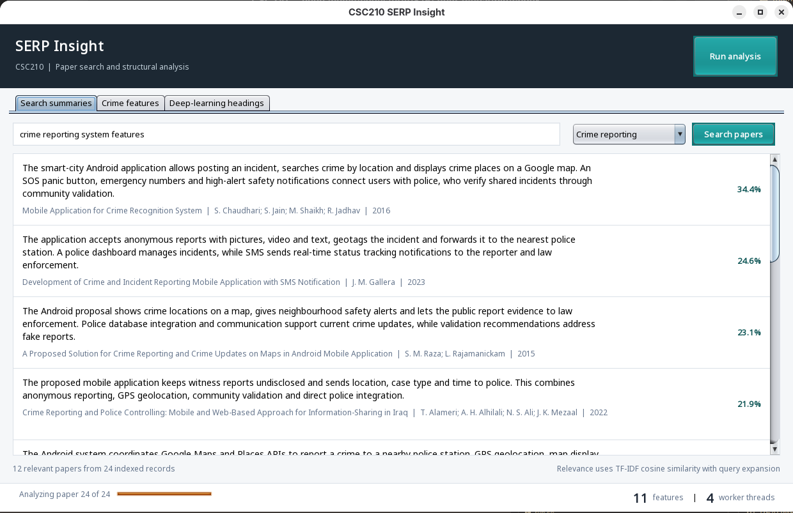
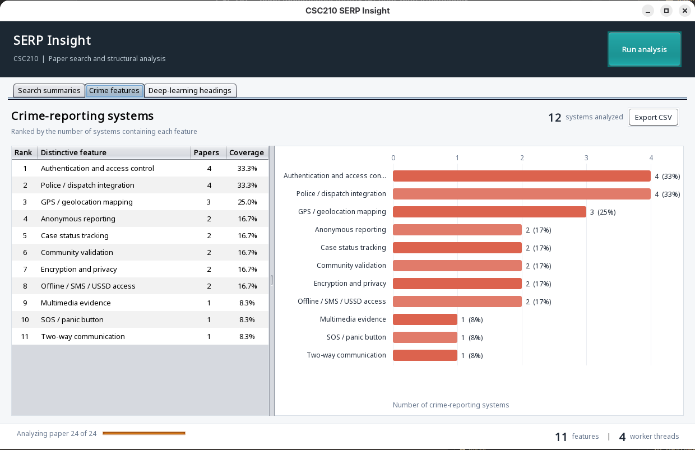
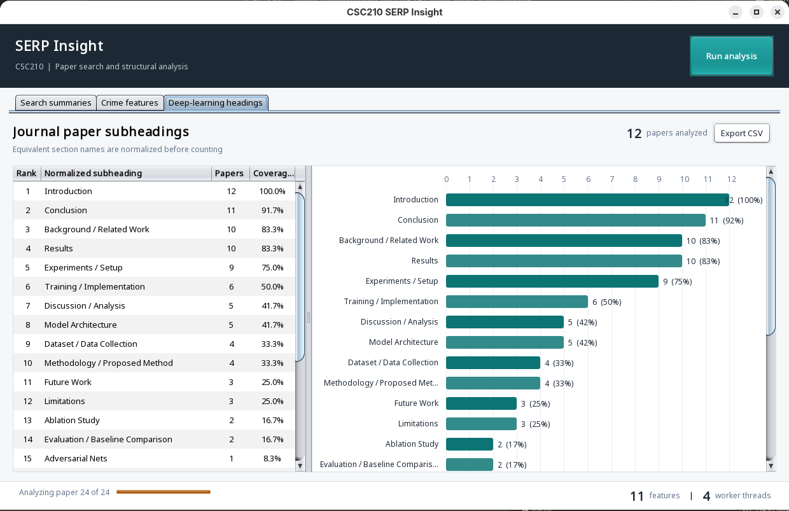
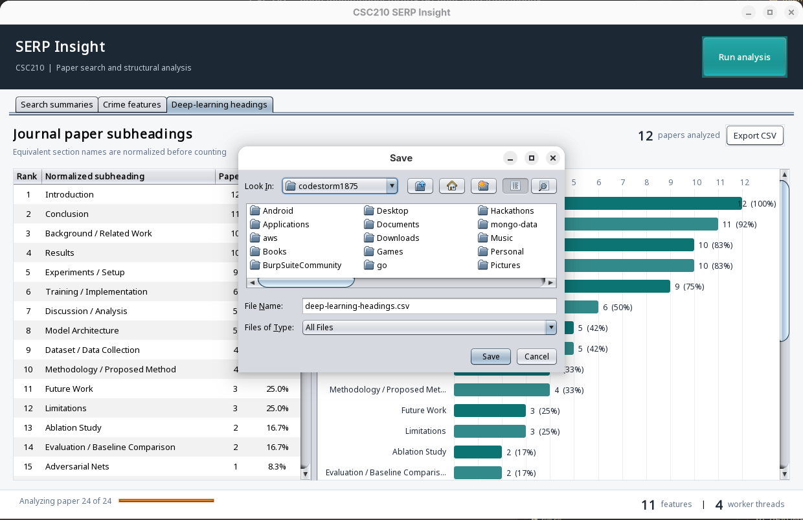

# CSC210 Assignment 1: Multithreaded SERP Analyzer

## 1. What was built

This project is a desktop Java application named **SERP Insight**. It addresses
the two parts of the assignment:

1. It searches and summarizes papers about crime-reporting systems, extracts
   their distinctive system features, counts how many systems contain each
   feature, sorts those counts from highest to lowest, and draws a bar chart.
2. It extracts subheadings from journal papers about deep-learning models,
   normalizes headings that mean the same thing, counts the papers containing
   each heading, sorts the results, and draws another bar chart.

The program has a Java Swing GUI and uses a fixed thread pool. It is built only
with the Java standard library, so Maven, Gradle, JavaFX, chart libraries, and
external API keys are not required.

The assignment text says "12. Distinct sub-headings". This implementation
interprets that as item **2**, not as a request for exactly twelve headings. The
program analyzes 12 deep-learning papers and currently finds 24 distinct
normalized subheadings.

## 2. Requirements mapping

| Assignment requirement | Implementation |
|---|---|
| Search-engine results | A local, reproducible SERP snapshot containing 24 paper records |
| Semantic search | Query expansion plus TF-IDF cosine similarity |
| More useful than titles and links | Query-aware extractive summaries are the main text in every search result |
| At least 10 crime-reporting papers | 12 published crime-reporting papers/system studies |
| Distinctive crime-reporting features | Controlled vocabulary containing 15 possible feature categories |
| Order by number of systems | Descending frequency and alphabetical tie-breaking |
| Deep-learning journal-paper subheadings | 12 well-known deep-learning paper records and 24 resulting headings |
| Visualization | Two custom horizontal bar charts and two ranked tables |
| Multithreading | One task per paper on a bounded `ExecutorService` pool |
| GUI | Java Swing desktop interface |
| Export | Each calculated table can be exported as CSV |
| Explanation | This document |

## 3. How to run it

### Prerequisites

Install JDK 17 or later. The project was developed and tested with OpenJDK 21.

Check Java:

```bash
java -version
javac -version
```

### Start the GUI

From the project directory:

```bash
./run.sh
```

The script performs three steps:

1. Compiles every source file under `src/main/java` into `build/classes`.
2. Copies `src/main/resources` into that classpath.
3. launches `serp.Main`.

### Run tests

```bash
./test.sh
```

There are 26 assertions. The tests run in headless mode, so they do not need a
desktop display.

### Print results without a GUI

```bash
./report.sh
```

This is useful when demonstrating the algorithms in a terminal or checking the
application on a machine with no graphical session.

## 4. GUI walkthrough

The top-right **Run analysis** button starts both assignment analyses. They also
run automatically when the application opens.

### Search summaries tab

Enter a natural-language query, select a paper category, and select **Search
papers**. The default query is `crime reporting system features`.

Each result displays:

- an extractive, query-focused summary as the primary content;
- the paper title, authors, and year as citation context;
- a semantic relevance percentage.



**Figure 1:** The search screen makes the generated summary more prominent than
the citation metadata. Results are ordered by their semantic relevance score.

Try these queries:

```text
anonymous crime location reporting
police status tracking
deep neural model architecture
training experiments and limitations
```

### Crime features tab

The left side is an exact ranked table. The right side is a horizontal bar chart.
The chart bar length is the number of crime-reporting systems in which the
feature was detected. Hovering over a bar shows its count and percentage.



**Figure 2:** Crime-reporting features appear as both an exact ranked table and a
horizontal frequency chart. The table and chart use the same `AnalysisReport`.

### Deep-learning headings tab

This view has the same table-and-chart layout. It counts each normalized heading
at most once per paper. This avoids a malformed paper containing the same heading
twice from artificially increasing the frequency.



**Figure 3:** The normalized subheading view shows the common structural pattern
of the selected papers and retains less common headings below the scroll area.

### CSV export

Selecting **Export CSV** opens the platform's save dialog with a descriptive
default filename. The exported file contains rank, label, paper count, and
coverage percentage.



**Figure 4:** Exporting the deep-learning headings as
`deep-learning-headings.csv`.

### Status bar

The bottom bar reports:

- current paper progress;
- total distinct crime features found;
- number of worker threads actually used;
- worker thread names and elapsed time after completion.

This is visible evidence that the program did not perform all analysis on the
Swing event-dispatch thread.

## 5. Project structure

```text
CSC210/
|-- src/
|   |-- main/
|   |   |-- java/serp/
|   |   |   |-- Main.java
|   |   |   |-- ReportCli.java
|   |   |   |-- analysis/
|   |   |   |   |-- AnalysisReport.java
|   |   |   |   |-- AnalysisService.java
|   |   |   |   |-- CrimeFeatureCatalog.java
|   |   |   |   `-- HeadingAnalyzer.java
|   |   |   |-- data/PaperRepository.java
|   |   |   |-- model/
|   |   |   |   |-- FrequencyItem.java
|   |   |   |   |-- Paper.java
|   |   |   |   `-- RankedPaper.java
|   |   |   |-- search/
|   |   |   |   |-- ExtractiveSummarizer.java
|   |   |   |   |-- SemanticSearchEngine.java
|   |   |   |   `-- TextProcessor.java
|   |   |   |-- ui/
|   |   |   |   |-- BarChartPanel.java
|   |   |   |   |-- FrequencyTableModel.java
|   |   |   |   |-- MainFrame.java
|   |   |   |   |-- SearchResultRenderer.java
|   |   |   |   `-- Theme.java
|   |   |   `-- util/CsvExporter.java
|   |   `-- resources/data/papers.tsv
|   `-- test/java/serp/TestRunner.java
|-- docs/screenshots/
|   |-- crime-features.png
|   |-- csv-export-dialog.png
|   |-- deep-learning-headings.png
|   `-- search-summaries.png
|-- README.md
|-- ASSIGNMENT_EXPLANATION.md
|-- run.sh
|-- report.sh
`-- test.sh
```

## 6. Data design and provenance

`papers.tsv` is an offline snapshot of information that would normally be
collected from search-engine result pages and the relevant papers. TSV means
tab-separated values. Every non-comment row has exactly eight fields:

```text
id, category, title, authors, year, URL, headings, content snapshot
```

The headings inside one field are separated with `||`.

There are two reasons for using a saved snapshot instead of scraping Google at
runtime:

1. The same input always produces the same output, which makes the assignment
   reproducible and testable.
2. Live search HTML, bot protection, network availability, and ranking changes
   would otherwise make a classroom demonstration unreliable.

The 12 crime records now identify published papers/system studies. The content
field is a concise reviewed description of features stated by each source. The
12 deep-learning records identify established primary papers, including ResNet,
U-Net, GAN, Transformer, EfficientNet, and BERT.

The snapshot is not a substitute for a systematic literature review. It is a
controlled dataset for demonstrating SERP processing algorithms. A production
system would retrieve licensed metadata from an API such as Crossref, Semantic
Scholar, or a university library service and cache the response.

## 7. End-to-end data flow

```text
papers.tsv
    |
    v
PaperRepository -----> List<Paper>
                            |
              +-------------+-------------+
              |                           |
              v                           v
  SemanticSearchEngine              AnalysisService
              |                           |
       RankedPaper list        one Callable per paper
              |                           |
  ExtractiveSummarizer          fixed ExecutorService
              |                           |
              v                 +---------+---------+
      Search summaries          |                   |
                                v                   v
                     CrimeFeatureCatalog     HeadingAnalyzer
                                |                   |
                                +---------+---------+
                                          |
                                   AnalysisReport
                                          |
                               tables + bar charts + CSV
```

## 8. Semantic search algorithm

The semantic search is deliberately small and explainable. It does not pretend
to be a large language model.

### Step 1: normalization

`TextProcessor` performs Unicode normalization, converts text to lowercase,
removes punctuation, removes common stop words, and applies light suffix
stemming.

Example:

```text
"Crime reports using locations"
        becomes
[crime, report, location]
```

### Step 2: query expansion

The search engine adds domain synonyms. For example:

```text
crime    -> incident, safety, police, emergency
report   -> reporting, complaint, evidence, witness
location -> GPS, geolocation, geotag, map
deep     -> neural, learning, model
heading  -> section, subheading, structure
```

This is the semantic part of the search. A paper does not need to contain the
user's exact word if it contains a known equivalent concept.

### Step 3: TF-IDF vectors

Term frequency measures how often a term occurs in one document. Inverse
document frequency reduces the influence of a term found in almost every paper.

```text
IDF(term) = log((N + 1) / (documentFrequency(term) + 1)) + 1

TF-IDF(term, document) = termFrequency * IDF(term)
```

`N` is the total number of indexed papers.

### Step 4: cosine similarity

The query and each paper become numeric vectors. Their relevance is:

```text
cosine(query, paper) = dot(query, paper)
                       -----------------
                       |query| * |paper|
```

A larger cosine value means the vectors point in a more similar direction. The
program sorts by descending relevance, then title for deterministic ties.

## 9. Extractive summarization

`ExtractiveSummarizer` does not invent new sentences. It splits the stored
content into sentences and selects the two sentences most relevant to the
expanded query.

Each sentence receives:

```text
score = matching query terms
      + matched terms / sentence terms
      + first-sentence bonus
```

The first-sentence bonus is small (`0.18`). It helps when two sentences have
similar term overlap because the opening sentence usually defines the system.

The two chosen sentences are restored to their original order and limited to
320 characters. This makes the output concise while keeping the summary grounded
in the paper snapshot.

This method is called **extractive summarization**. An abstractive summarizer
would generate new wording and would require a language model or a more complex
natural-language-processing library.

## 10. Crime-feature extraction

Different authors can describe the same feature differently. A direct count of
words would wrongly treat `GPS`, `geolocation`, and `map location` as unrelated.

`CrimeFeatureCatalog` solves this with a controlled vocabulary. Examples:

| Canonical feature | Matching expressions |
|---|---|
| Anonymous reporting | anonymous report, anonymity, anonymous mode |
| GPS / geolocation mapping | GPS, geolocation, geotag, crime map |
| Multimedia evidence | photo evidence, video evidence, audio evidence, multimedia |
| Real-time safety alerts | push notification, emergency alert, real-time alert |
| Case status tracking | status tracking, case progress, track case |
| Police / dispatch integration | police integration, police dispatch, law enforcement integration |
| Encryption and privacy | encryption, encrypted, privacy preservation |
| Offline / SMS / USSD access | offline, SMS, USSD |
| SOS / panic button | SOS, panic button |
| Community validation | moderator review, crowdsourced verification, community validation |

There are 15 possible feature categories in the catalog. The current corpus
contains matches for 11 of them. Detection returns a `Set<String>`, so a feature
mentioned five times in one paper still contributes only one system to its
frequency.

After all tasks finish, `AnalysisService` merges the sets:

```text
for each analyzed paper:
    for each unique feature in that paper:
        featureCount[feature] += 1
```

Coverage is:

```text
coverage percentage = matching crime papers / 12 * 100
```

## 11. Deep-learning heading extraction

The input keeps headings in source order, but frequency analysis needs canonical
names. `HeadingAnalyzer` maps variants such as:

```text
Related Work, Literature Review, Background
    -> Background / Related Work

Experimental Setup, Experimental Settings, Experiments
    -> Experiments / Setup

Network Architecture, BERT Architecture, Model Architecture
    -> Model Architecture

Conclusions and Future Work
    -> Future Work
```

`Abstract` is excluded because it is front matter rather than a subheading in
the analysis. Unrecognized domain-specific headings are preserved in title case
instead of being discarded. Examples include `Adversarial Nets` and `Taxonomy`.

The normalized headings for each paper are put in a set before aggregation. As
with features, one paper can contribute at most one count to a heading.

## 12. Multithreading design

### Why threads are useful here

Each paper can be analyzed independently. Paper C01 does not need the result of
paper D12. This is an embarrassingly parallel problem and is a good use of a
fixed thread pool.

### Thread pool

The GUI creates between two and four workers depending on available processors:

```java
int threadCount = Math.min(4,
        Math.max(2, Runtime.getRuntime().availableProcessors()));
```

`AnalysisService` creates an `ExecutorService` with identifiable names such as
`paper-worker-1`.

### Task creation

The service maps each `Paper` to a `Callable<PaperAnalysis>`. With 24 papers,
there are 24 tasks. Only the fixed number of workers execute simultaneously,
which prevents unbounded thread creation.

```text
24 paper tasks
      |
      v
+-------------------------------+
| fixed pool                    |
| worker-1 worker-2 worker-3... |
+-------------------------------+
      |
      v
24 immutable PaperAnalysis results
```

Crime papers run feature extraction. Deep-learning papers run heading
normalization. Every task records its executing thread name and increments an
`AtomicInteger` progress counter.

### Safe aggregation

Worker tasks do not mutate shared frequency maps. Each task returns immutable
sets. The calling background thread waits on the futures and then merges the
results sequentially. This design avoids races and does not require locking the
maps.

### Keeping the GUI responsive

Swing has one event-dispatch thread (EDT). Long work on the EDT freezes buttons,
repainting, and window movement. `MainFrame` therefore starts a `SwingWorker`:

- `doInBackground()` calls the multithreaded analysis service away from the EDT.
- progress changes are posted back with `SwingUtilities.invokeLater()`.
- `done()` updates tables and charts on the EDT.

This creates two levels of responsibility:

```text
Swing EDT: user input and painting only
SwingWorker background thread: coordinates analysis
paper-worker threads: analyze individual papers concurrently
```

### Shutdown

When the window closes, `analysisService.close()` calls `shutdownNow()`. The
workers are also daemon threads, so they cannot accidentally keep the JVM alive.

## 13. Visualization implementation

`BarChartPanel` extends `JPanel` and overrides `paintComponent`.

For every result, the bar width is calculated as:

```text
barWidth = chartWidth * itemCount / maximumCount
```

The panel draws:

- integer grid lines from zero to the maximum count;
- a label for each feature or heading;
- a horizontal colored bar;
- the exact count and coverage percentage;
- a tooltip containing the same values.

The chart's preferred height grows with the number of rows. It is placed inside
a scroll pane so 24 heading categories remain readable instead of becoming
compressed.

No chart dependency is used. This makes the drawing code part of the submitted
algorithm and keeps the project easy to compile in a lab.

## 14. Current reproducible results

Run `./report.sh` to recalculate these values.

### Crime-reporting feature ranking

| Rank | Feature | Systems | Coverage |
|---:|---|---:|---:|
| 1 | Authentication and access control | 4 | 33.3% |
| 2 | Police / dispatch integration | 4 | 33.3% |
| 3 | GPS / geolocation mapping | 3 | 25.0% |
| 4 | Anonymous reporting | 2 | 16.7% |
| 5 | Case status tracking | 2 | 16.7% |
| 6 | Community validation | 2 | 16.7% |
| 7 | Encryption and privacy | 2 | 16.7% |
| 8 | Offline / SMS / USSD access | 2 | 16.7% |
| 9 | Multimedia evidence | 1 | 8.3% |
| 10 | SOS / panic button | 1 | 8.3% |
| 11 | Two-way communication | 1 | 8.3% |

### Most frequent deep-learning headings

| Rank | Normalized heading | Papers | Coverage |
|---:|---|---:|---:|
| 1 | Introduction | 12 | 100.0% |
| 2 | Conclusion | 11 | 91.7% |
| 3 | Background / Related Work | 10 | 83.3% |
| 4 | Results | 10 | 83.3% |
| 5 | Experiments / Setup | 9 | 75.0% |
| 6 | Training / Implementation | 6 | 50.0% |
| 7 | Discussion / Analysis | 5 | 41.7% |
| 8 | Model Architecture | 5 | 41.7% |
| 9 | Dataset / Data Collection | 4 | 33.3% |
| 10 | Methodology / Proposed Method | 4 | 33.3% |
| 11 | Future Work | 3 | 25.0% |
| 12 | Limitations | 3 | 25.0% |

There are 12 additional domain-specific or less frequent headings in the full
output, for a total of 24.

## 15. Class-by-class explanation

### Model classes

- `Paper` is an immutable record containing all normalized input fields.
- `RankedPaper` combines a paper, relevance score, and generated summary.
- `FrequencyItem` combines a canonical label, paper count, and percentage.

Using records reduces mutable state and makes values safer to pass between
threads.

### Data class

- `PaperRepository` reads the TSV resource, validates that every row has eight
  fields, converts categories and years, and returns an immutable list.

### Search classes

- `TextProcessor` supplies consistent normalization, tokenization, stop-word
  removal, and light stemming.
- `SemanticSearchEngine` builds IDF statistics, expands queries, calculates
  cosine similarity, filters, and sorts.
- `ExtractiveSummarizer` scores and selects query-relevant sentences.

### Analysis classes

- `CrimeFeatureCatalog` owns the controlled vocabulary and detects features.
- `HeadingAnalyzer` owns the heading-normalization rules.
- `AnalysisService` manages the executor, paper tasks, progress, and aggregation.
- `AnalysisReport` is the immutable final value sent to either GUI or CLI.

### UI classes

- `MainFrame` composes the application and coordinates user actions.
- `SearchResultRenderer` gives each summary a readable result layout.
- `FrequencyTableModel` adapts frequency values for `JTable`.
- `BarChartPanel` paints the visualization.
- `Theme` centralizes UI colors and fonts.

### Utility and entry points

- `CsvExporter` writes quoted, UTF-8 CSV output.
- `Main` starts Swing on the EDT.
- `ReportCli` prints the same analysis without a graphical display.

## 16. Testing strategy

`TestRunner` uses Java assertions and explicit checks instead of JUnit, so no
dependency download is required. It verifies:

1. Exactly 24 records load: 12 in each category.
2. Every paper ID is unique.
3. Search returns relevant, category-correct, descending results.
4. Every search result has a bounded, nonempty summary.
5. Query expansion retrieves deep-learning results.
6. Representative synonyms map to five crime features.
7. Four heading-normalization rules behave correctly.
8. At least 10 crime features and at least 12 headings are found.
9. Frequencies are descending.
10. Named worker threads execute the analysis and at least two are used.
11. CSV output has the correct header and row count.
12. The chart paints non-background pixels into an off-screen image.

The final test is important because a chart component can compile successfully
but still display a blank surface due to bad dimensions or paint logic.

## 17. Complexity

Let:

- `P` = number of papers;
- `T` = average token count per paper;
- `F` = number of controlled crime features;
- `H` = average number of headings per deep-learning paper.

Approximate costs are:

| Operation | Time | Space |
|---|---:|---:|
| Build document frequencies | `O(P * T)` | `O(V)` vocabulary |
| Search one query | `O(P * T)` | `O(V)` temporary vectors |
| Crime feature analysis | `O(P * F * text length)` | `O(P * F)` results |
| Heading analysis | `O(P * H)` | `O(P * H)` results |
| Sort frequency output | `O(K log K)` | `O(K)` |

The corpus is intentionally small, so clarity matters more than micro-
optimization. Parallelism becomes more valuable when `P` grows or when paper
retrieval and PDF parsing are added.

## 18. Limitations and responsible interpretation

1. **Offline corpus:** Results describe the bundled snapshot, not every paper on
   the web and not today's live Google ordering.
2. **Controlled synonyms:** A new phrase is missed until added to the catalog.
3. **Substring feature extraction:** The method is transparent but less capable
   than a trained entity classifier.
4. **Small semantic layer:** Query expansion captures domain relationships but
   not the full contextual meaning of transformer embeddings.
5. **Extractive summaries:** They remain faithful to source text but may be less
   fluent than abstractive summaries.
6. **Curated headings:** The heading lists are a research snapshot. A production
   tool would parse publisher HTML or PDF structure and retain page references.
7. **Corpus bias:** Frequency means prevalence in these 12 systems, not prevalence
   in all deployed crime-reporting software.

These limitations should be stated during a presentation. Being precise about
what the output represents is stronger than claiming universal conclusions from
a small sample.

## 19. Suggested live demonstration

1. Run `./test.sh` and show all 26 checks passing.
2. Run `./run.sh` and show that the window remains responsive during analysis.
3. Point to the worker count and names in the status bar.
4. Search `anonymous crime location reporting` and explain query expansion.
5. Open **Crime features** and compare the count table with bar lengths.
6. Open **Deep-learning headings** and explain why variants are normalized.
7. Export either table to CSV.
8. Run `./report.sh` to prove the GUI and headless result use the same service.

## 20. Likely viva questions and answers

### Why did you use a fixed thread pool?

A fixed pool bounds resource usage. Creating one raw thread for every result does
not scale, while a pool reuses a small number of workers.

### Why is the program thread-safe?

Paper tasks read immutable input and return their own immutable sets. They do not
write to shared count maps. Aggregation happens after the futures complete on one
coordinating thread. Progress uses `AtomicInteger`.

### Why use `SwingWorker` if there is already an executor?

They solve different problems. `SwingWorker` moves coordination away from the
GUI thread. The executor parallelizes individual paper analyses.

### What makes the search semantic?

Domain query expansion connects related meanings such as location, GPS,
geolocation, and map. TF-IDF then weights the expanded concepts by how
informative they are in this corpus.

### How are ties ordered?

Frequency results use descending count and then alphabetical label. Search uses
descending cosine relevance and then paper title. This makes output deterministic.

### Why summarize instead of only showing titles and URLs?

A title may not reveal why a result matches the query. The extractive summary
selects the sentences with the strongest expanded-query overlap, allowing the
user to judge relevance before following the citation.

### How would you improve this for production?

Use a permitted scholarly API, cache results, parse full text with Apache Tika,
replace manual query expansion with sentence embeddings, evaluate summaries with
human relevance judgments, store provenance for every extracted phrase, and use
a persistent database for a much larger corpus.

## 21. Conclusion

The project demonstrates the complete route from a SERP-like paper collection to
useful ranked knowledge. It does not stop at displaying titles and links: it
performs semantic retrieval, grounded summaries, concurrent paper analysis,
normalization, frequency ranking, visualization, and export. The same core
service drives the GUI, command-line report, and automated tests, which keeps the
calculated results consistent across every way the assignment can be evaluated.
