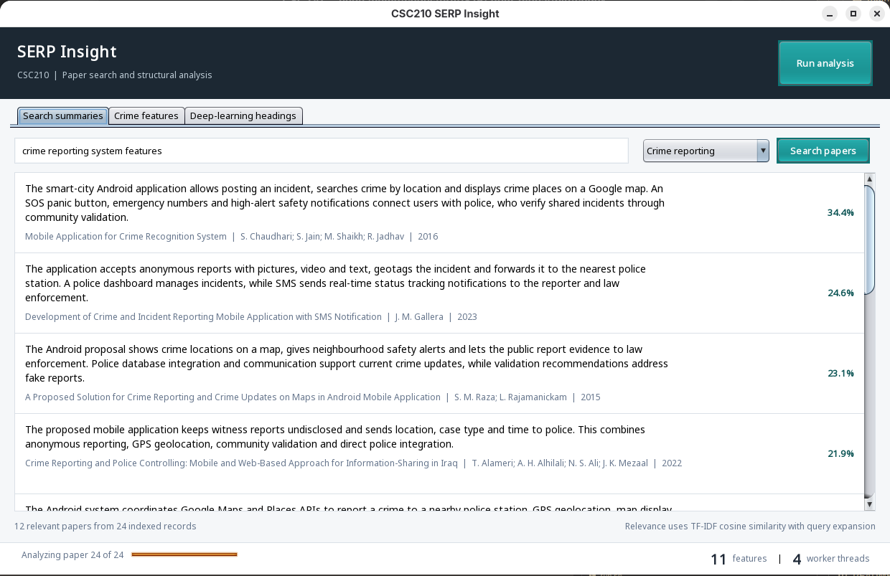
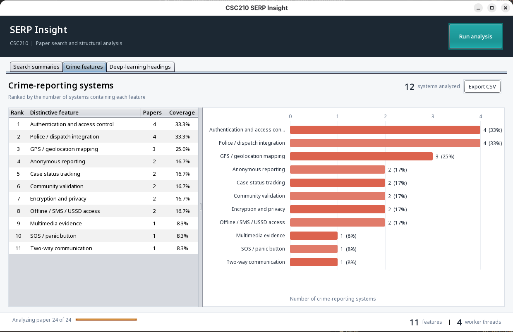
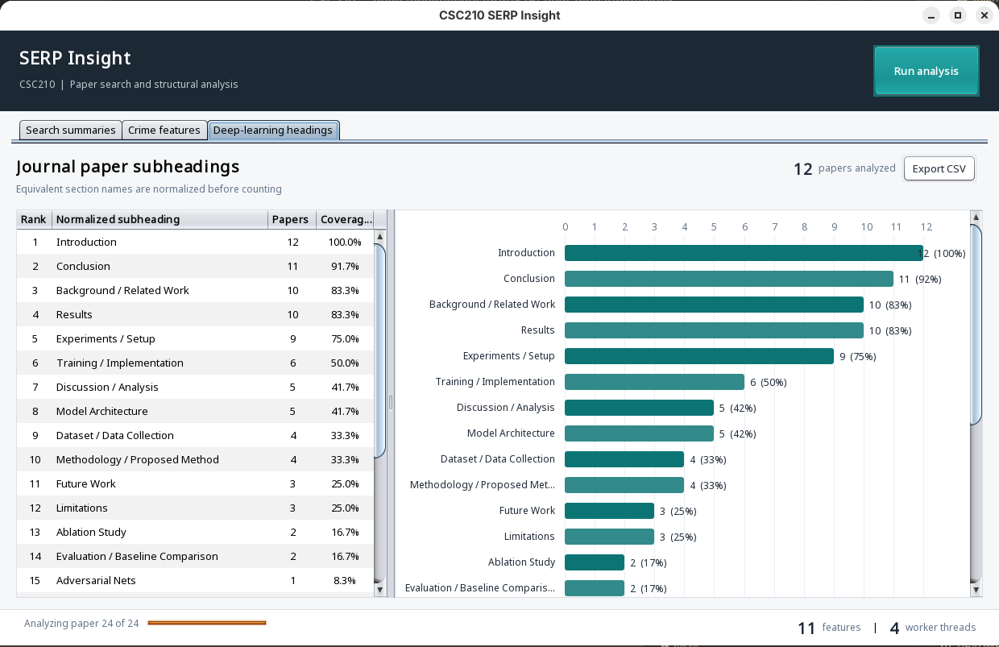
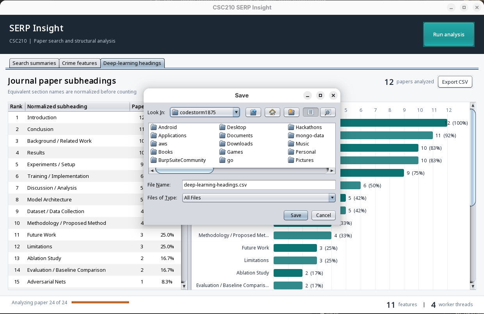

# CSC210 SERP Analyzer

A dependency-free Java Swing application for Assignment 1. It performs semantic
search over a reproducible paper SERP snapshot, summarizes relevant results,
extracts and ranks crime-reporting system features, and counts normalized
subheadings from deep-learning papers.

## Requirements

- JDK 17 or newer (JDK 21 is recommended)
- Bash for the convenience scripts

## Run

```bash
./run.sh
```

## Test

```bash
./test.sh
```

For the same calculated tables without launching the GUI:

```bash
./report.sh
```

See `ASSIGNMENT_EXPLANATION.md` for the full design, algorithms, threading model,
data notes, screenshots guide, and presentation outline.

## Screenshots

| Semantic summaries | Crime-feature visualization |
|---|---|
|  |  |

| Deep-learning headings | CSV export |
|---|---|
|  |  |
