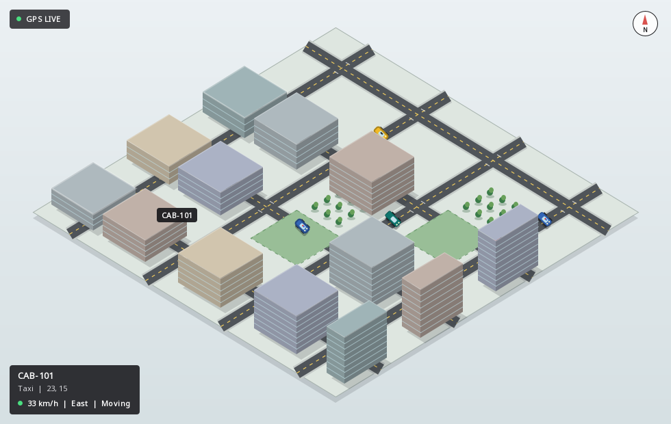

# Assignment 2: Tracking Fleet Vehicles

## 1. Objective

This project implements the fleet vehicle tracker example using Java's monitor
pattern and a Swing graphical interface. It models taxicabs, police cars,
delivery vans, and trucks. Every vehicle has a unique `String` ID and a mutable
location represented by integer `(x, y)` coordinates.

The central problem is concurrent access:

- several simulated GPS threads update vehicle locations;
- the Swing event-dispatch thread reads all locations and paints the map;
- a dispatcher can manually move a selected vehicle from the GUI.

Without synchronization, the view could observe partially updated coordinates,
iteration could conflict with modification, or callers could mutate tracker
state through a leaked reference.

## 2. Running the application

Requirements: JDK 17 or newer and Bash.

```bash
cd /home/codestorm1875/School/CSC210/assignment2
./run.sh
```

Run the test suite with:

```bash
./test.sh
```

## 3. Main design

```text
GPS worker 1 ----+
GPS worker 2 ----+                         +--> vehicle table
GPS worker 3 ----+--> MonitorVehicleTracker+--> live map
GPS worker 4 ----+      synchronized       +--> detail panel
                         methods            |
Dispatcher GUI --------> setLocation()     |
Swing refresh timer ---> getLocations() ---+
```

The tracker is the model. `MainFrame`, `VehicleTableModel`, and `FleetMapPanel`
form the view/controller layer. `FleetSimulator` represents external GPS devices.

## 4. The mutable point

`MutablePoint` contains two public integer fields:

```java
public int x;
public int y;
```

It is deliberately not thread-safe. This matches the monitor-pattern example:
the enclosing tracker, rather than each point, owns responsibility for
synchronization.

The class provides a copy constructor:

```java
public MutablePoint(MutablePoint point) {
    this(point.x, point.y);
}
```

That constructor is the basis of defensive copying.

## 5. Java monitor pattern

Every public operation that reads or changes the location map is declared
`synchronized`:

```java
public synchronized Map<String, MutablePoint> getLocations()
public synchronized MutablePoint getLocation(String vehicleId)
public synchronized void setLocation(String vehicleId, int x, int y)
public synchronized int size()
```

For an instance synchronized method, Java acquires the intrinsic lock associated
with `this` before entering the method and releases it when the method returns or
throws an exception.

Therefore, only one thread at a time can inspect or mutate the tracker state.
The lock protects both the map structure and every mutable point stored in it.

## 6. Encapsulation invariant

The tracker's safety depends on this invariant:

> Neither the internal map nor any `MutablePoint` stored inside it is ever
> published to a caller.

The constructor does not retain the caller's map. It builds a deep copy:

```java
this.locations = mutableDeepCopy(locations);
```

Changing the original map or its points after construction therefore cannot
change the tracker.

`getLocation` returns a copy of one point:

```java
return location == null ? null : new MutablePoint(location);
```

`getLocations` deep-copies every point and wraps the copied map with
`Collections.unmodifiableMap`. The map structure cannot be changed by the
caller. Its copied points are still mutable, but changing them affects only that
snapshot, never the tracker.

## 7. Snapshot semantics

Suppose the view obtains this snapshot:

```java
Map<String, MutablePoint> snapshot = tracker.getLocations();
```

If a GPS thread changes `CAB-101` immediately afterwards, `snapshot` keeps the
old coordinates. This is a stable, internally consistent view of one moment in
time.

The benefit is predictable rendering: every vehicle in one screen refresh comes
from the same synchronized copy operation. The tradeoff is that snapshots become
stale. The GUI handles this by requesting a new snapshot every 350 milliseconds.

Deep copying takes time proportional to the number of vehicles. That is normally
acceptable for a small or medium fleet, but a very large fleet may need a more
scalable design such as immutable points stored in a concurrent map.

## 8. Atomic coordinate updates

`setLocation` updates both fields while holding the same monitor:

```java
public synchronized void setLocation(String id, int x, int y) {
    MutablePoint point = locations.get(id);
    if (point == null) {
        throw new IllegalArgumentException("No such vehicle: " + id);
    }
    point.x = x;
    point.y = y;
}
```

A reader cannot enter `getLocation` or `getLocations` between those two field
assignments. It observes the coordinate pair before the update or after the
update, never a mixture of the two.

Unknown vehicle IDs are rejected instead of silently creating records. The set
of known fleet vehicles is fixed after tracker construction.

## 9. GPS updater threads

`FleetSimulator` uses a four-thread `ScheduledExecutorService`. It schedules one
repeating task for every vehicle. The fixed pool reuses four named workers:

```text
gps-updater-1
gps-updater-2
gps-updater-3
gps-updater-4
```

Each task:

1. obtains a defensive copy with `getLocation`;
2. maintains a small per-vehicle direction state;
3. moves along one of the modeled horizontal or vertical roads;
4. may turn when it reaches an intersection;
5. clamps the location to the 0-100 map boundary;
6. submits the new coordinate through synchronized `setLocation`;
7. increments an atomic update counter.

The simulation can be paused and resumed. Pausing changes an `AtomicBoolean`, so
workers see the state change safely without requiring the tracker lock.

Worker names are stored in a concurrent set and shown in the GUI as evidence
that multiple updater threads have actually executed.

## 10. Swing thread model

Swing components must be accessed on the event-dispatch thread (EDT). `Main`
creates the window with `SwingUtilities.invokeLater`.

A `javax.swing.Timer` fires on the EDT every 350 milliseconds. Its listener gets
a tracker snapshot, updates the table model, replaces the map snapshot, refreshes
the selected-vehicle details, and repaints the map.

The GPS scheduler never modifies Swing components. The EDT never receives a
reference to the tracker's internal points. This separation keeps both the model
and the GUI safe.

## 11. GUI functionality

### Fleet table

The table displays vehicle ID, type, X coordinate, and Y coordinate. It can be
filtered by free text or by Taxi, Police, Delivery van, or Truck.

### Live dispatch map

The map uses an isometric projection to convert logical 0-100 coordinates into
a city scene. `FleetMapPanel` paints the ground plane, streets, lane markings,
parks, trees, extruded buildings, compass, and live GPS state with Java2D. It
does not require an external map service or graphics dependency.

Buildings and vehicles share a depth-sorted scene pass. A car is painted before
a nearer building when it is on a road behind that building, so the building
correctly occludes it. Ground-level route trails are painted before all
buildings. This prevents cars and trails from appearing on rooftops.

Vehicles are recognizable top-down bodies rather than dots. Taxis, police cars,
delivery vans, and trucks have distinct colors and proportions. Police vehicles
also have a red-blue light bar. Shadows and windscreen highlights make the
vehicles readable against both roads and buildings.

Tracker snapshots arrive every 350 milliseconds, but the map repaints at about
60 frames per second while visible. Each vehicle stores its previous and target
coordinates and applies smooth-step interpolation between them. This makes the
GPS updates look like continuous travel without changing the thread-safe model
or inventing intermediate tracker state. Short translucent trails show recent
movement.



Selecting a table row highlights the corresponding vehicle with a pulse ring.
A vehicle can also be selected directly on the map, which synchronizes the
table and dispatcher panel. Hovering displays its ID, type, and live coordinates.

Successive GPS targets also produce view-only telemetry:

- estimated speed in kilometres per hour;
- cardinal heading;
- moving, idle, or stale-signal status;
- time since the last changed GPS position.

The fleet table shows speed and heading for comparison. The selected-vehicle
panel and map HUD show the complete telemetry set. Telemetry is derived outside
the tracker, so it does not enlarge the monitor's protected mutable state.

### Dispatcher controls

Select a vehicle, enter X and Y values, and press **Move vehicle**. The same move
can be performed by clicking a destination on the map. Both paths call
`MonitorVehicleTracker.setLocation`, just like a real external updater.

### Simulation controls

- **Pause updates** stops simulated GPS movement without closing workers.
- **Resume updates** continues movement.
- **Reset fleet** restores the initial coordinates.

### Operational status

The footer displays whether feeds are live, total GPS update count, actual
worker-thread count, snapshot number, and refresh time.

## 12. Source structure

```text
assignment2/
|-- src/main/java/fleet/
|   |-- Main.java
|   |-- data/FleetData.java
|   |-- model/
|   |   |-- MonitorVehicleTracker.java
|   |   `-- MutablePoint.java
|   |-- service/FleetSimulator.java
|   `-- ui/
|       |-- FleetMapPanel.java
|       |-- MainFrame.java
|       |-- SimpleDocumentListener.java
|       |-- Theme.java
|       |-- UiKit.java
|       `-- VehicleTableModel.java
|-- src/test/java/fleet/TestRunner.java
|-- ASSIGNMENT_EXPLANATION.md
|-- README.md
|-- run.sh
`-- test.sh
```

## 13. Test coverage

The dependency-free test runner verifies that:

1. constructor input points are copied;
2. the constructor does not retain the caller's map;
3. `getLocation` returns a defensive copy;
4. an old snapshot remains unchanged after an update;
5. the tracker receives the new location;
6. the snapshot map is unmodifiable;
7. an unknown vehicle update throws `IllegalArgumentException`;
8. concurrent readers never observe a partially updated coordinate pair;
9. the GPS simulator produces changes;
10. more than one GPS worker executes;
11. pausing stops the update count;
12. speed is derived from a changed GPS position;
13. heading is derived from movement direction;
14. the map paints nonblank pixels in headless mode.

The atomic-pair test runs two writers repeatedly setting `(11, 11)` and
`(22, 22)` while a reader performs 60,000 reads. Any mixed pair would demonstrate
a failure of the synchronization boundary.

## 14. Complexity and tradeoffs

Let `V` be the number of fleet vehicles.

| Operation | Time | Extra space |
|---|---:|---:|
| `getLocation(id)` | approximately `O(1)` | `O(1)` |
| `setLocation(id)` | approximately `O(1)` | `O(1)` |
| `getLocations()` | `O(V)` | `O(V)` |
| one GUI refresh | `O(V)` | `O(V)` snapshot |

The simple monitor makes correctness easy to reason about, but all tracker
operations are serialized. Deep-copy snapshots also allocate new objects on each
refresh. This is suitable for teaching and for modest fleet sizes.

For a much larger system, possible alternatives include immutable `Point`
objects in a `ConcurrentHashMap`, read-write locks, event-driven incremental
updates, or the publishing-vehicle-tracker design using `SafePoint`. Those
approaches reduce copying or contention but require more careful reasoning about
the consistency guarantees exposed to clients.

## 15. Suggested demonstration

1. Run `./test.sh` and show all concurrency checks passing.
2. Run `./run.sh` and select a vehicle in the table.
3. Watch the table and map change while the footer reports multiple GPS workers.
4. Pause updates and show that coordinates stop changing.
5. Enter a new coordinate and move the selected vehicle.
6. Click another map location to dispatch it again.
7. Apply the Police filter and then reset the fleet.
8. Explain why the map is rendering a snapshot instead of the internal map.

## 16. Conclusion

The implementation demonstrates the Java monitor pattern in a realistic GUI
scenario. A private mutable model remains thread-safe because its state is fully
encapsulated, all access is synchronized, and every published location is a
defensive copy. Multiple GPS threads, manual dispatch actions, and the Swing view
can therefore operate concurrently without exposing partially updated or
externally mutable tracker state.
