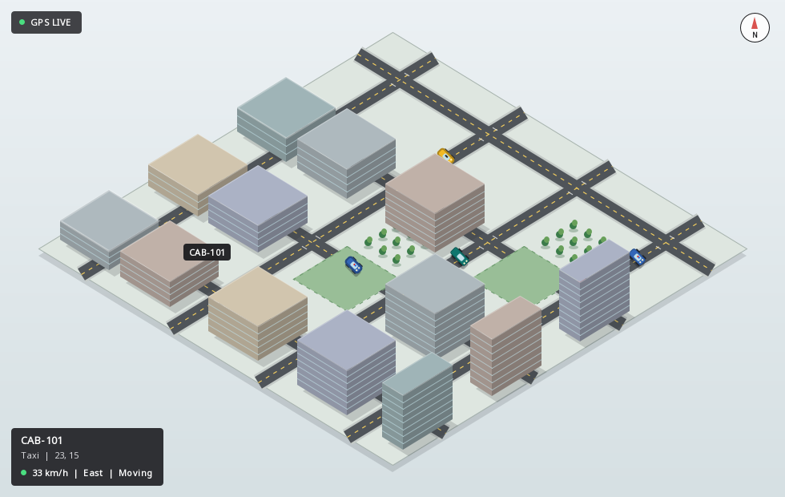

# Assignment 2: Fleet Vehicle Tracker

A Java Swing implementation of the monitor-pattern vehicle tracker example.
Multiple simulated GPS threads move distinct vehicle types through a road
network while the Swing event thread reads stable, defensive-copy snapshots.
The live Java2D map renders an isometric city and smoothly interpolates taxis,
police cars, delivery vans, and trucks between GPS updates.



## Run

```bash
cd assignment2
./run.sh
```

## Test

```bash
./test.sh
```

See `ASSIGNMENT_EXPLANATION.md` for the design, monitor invariant, threading
model, GUI workflow, tests, and presentation notes.
