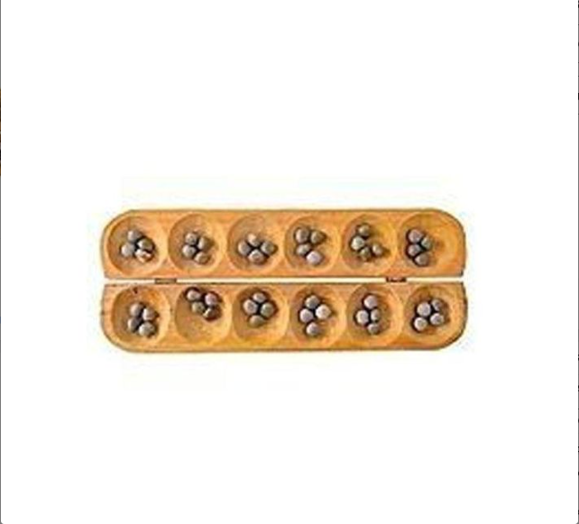
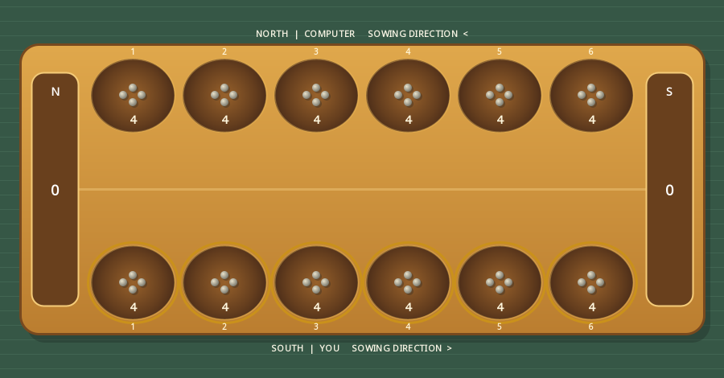

# Assignment 3: Description and Implementation of Ayo Olopon

## 1. Introduction

Ayo Olopon is a traditional Yoruba two-player sow-and-capture board game. It is
part of the wider Mancala family. The physical board has two rows of six pits,
and the standard opening places four seeds in every pit. Therefore:

```text
12 pits * 4 seeds = 48 seeds
```

This assignment implements Ayo as a complete Java Swing desktop game. It
contains a rules engine, interactive graphical board, local two-player mode,
computer-opponent mode, move history, undo, score tracking, legal-move
highlighting, and automated tests.

The provided board photograph was used as a visual reference:



The playable board is drawn with Java `Graphics2D`, rather than using the image
as a fixed background. This allows every pit and every seed count to respond to
the actual game state.

## 2. Running the game

Requirements: JDK 17 or newer and Bash.

```bash
cd /home/codestorm1875/School/CSC210/assignment3
./run.sh
```

Run all automated tests with:

```bash
./test.sh
```

No Maven, Gradle, external graphics framework, or third-party game library is
required.

## 3. Rules implemented

Ayo rules have regional and tournament variations. This program states its
variant explicitly so that the behavior is deterministic.

### Board and ownership

- The board has 12 pits.
- South owns the six bottom pits.
- North owns the six top pits.
- Each pit begins with four seeds.
- South moves first.

### Sowing

The player selects a nonempty pit on their own side, removes all its seeds, and
drops one seed in each following pit counter-clockwise.

If a move contains enough seeds to make a full circuit, the original source pit
is skipped. It remains empty during that lap, and sowing continues in the next
pit.

### Capturing

A capture is considered only when the final seed lands on the opponent's side.
If that pit then contains exactly two or three seeds, all its seeds are captured.

The engine then moves backward from the landing pit. Each immediately preceding
opponent pit containing two or three seeds is also captured. The chain stops at
the first pit that:

- belongs to the moving player; or
- does not contain two or three seeds.

### Feeding and starvation

If the opponent has no seeds, the current player must choose a move that sows at
least one seed onto the opponent's side, when such a move exists.

A capture that would remove every seed from the opponent's side is cancelled.
This is commonly called the grand-slam or starvation rule. The sowing still
happens, but the opponent keeps the seeds that would have been captured.

### Ending the game

A player wins as soon as they capture more than half of the 48 seeds, meaning at
least 25. A 24-24 result is a draw.

If the next player has no legal move, all seeds remaining in each player's row
are moved to that player's captured score and the larger score wins. A move
limit also resolves an exceptionally repetitive position by the same method.

## 4. Board representation

The engine uses a fixed integer array:

```java
int[] board = new int[12];
```

The counter-clockwise sowing path is the increasing array order:

```text
                         North
                  visual top row
             +----+----+----+----+----+----+
pit index    | 11 | 10 |  9 |  8 |  7 |  6 |
             +----+----+----+----+----+----+
pit index    |  0 |  1 |  2 |  3 |  4 |  5 |
             +----+----+----+----+----+----+
                  visual bottom row
                         South

sowing path: 0 -> 1 -> 2 -> 3 -> 4 -> 5 -> 6 -> ... -> 11 -> 0
```

The top row is displayed in reverse index order. That makes increasing numeric
indices travel right along the lower row and then left along the upper row,
forming a counter-clockwise circuit on screen.

South owns indices `0..5`. North owns indices `6..11`.

## 5. Core model classes

### `Player`

The enum stores the display name and owned index range. It provides:

```java
boolean owns(int pit)
Player opponent()
```

Centralizing ownership avoids repeating fragile index checks throughout the
rules engine.

### `GameSnapshot`

`GameSnapshot` is an immutable description of one game state. It stores:

- a defensive copy of all 12 pits;
- South and North captured scores;
- current player;
- game-over and winner values;
- move number;
- current status message.

The record overrides `board()` to return another copy. A caller cannot modify
the live game by changing the returned array.

### `MoveResult`

Every successful move produces a value containing:

- moving player;
- source pit;
- final landing pit;
- number of captured seeds;
- captured pit indices;
- human-readable move description.

The GUI uses this result for history and visual highlights. It does not need to
recalculate the move.

### `AyoGame`

This is the authoritative rules engine. It validates moves, sows seeds, finds
capture chains, applies scores, changes turns, detects the end of the game, and
stores snapshots for undo.

The Swing classes never implement game rules. This separation allows the engine
to be tested without opening a window.

## 6. Sowing algorithm

The selected pit is emptied before sowing:

```java
int seeds = board[sourcePit];
board[sourcePit] = 0;
```

The current index advances modulo 12:

```java
pit = (pit + 1) % 12;
```

Modulo arithmetic changes index 11 back to index 0. When the index returns to
the source, that pit is skipped without consuming a seed:

```java
if (pit == sourcePit) continue;
```

Otherwise, the algorithm adds one seed and decreases the seeds in hand.

### Opening example

Every pit starts at four. South selects pit 0:

```text
Before: [4, 4, 4, 4, 4, 4, 4, 4, 4, 4, 4, 4]
Pick up: 4 seeds from pit 0
Drop in: pits 1, 2, 3, 4
After:  [0, 5, 5, 5, 5, 4, 4, 4, 4, 4, 4, 4]
```

The final seed lands in pit 4, which belongs to South, so no capture occurs.

## 7. Capture algorithm

After sowing, the engine begins at the landing pit. It checks three conditions:

```text
1. the pit belongs to the opponent;
2. it contains exactly 2 or 3 seeds;
3. the chain has not crossed onto the mover's side.
```

Each qualifying index is stored in a capture list. The cursor moves backward
with:

```java
pit = (pit + 12 - 1) % 12;
```

The capture is not applied immediately. The engine first totals all candidate
seeds and compares that value with the opponent's entire row. If both totals are
equal, the capture would starve the opponent and is cancelled.

### Chain example

Suppose South sows from pit 5 and finishes at North's pit 7:

```text
pit 7 becomes 2 -> capture candidate
pit 6 contains 2 -> previous capture candidate
pit 5 is South's -> stop
```

Pits 7 and 6 are emptied, and South's captured score increases by four.

## 8. Legal-move calculation

For a normal turn, every nonempty pit owned by the current player is legal.

When the opponent's row is empty, the engine simulates the sowing path of each
candidate just far enough to determine whether it crosses onto the opponent's
side. Only feeding moves remain legal.

The GUI requests `game.legalMoves()` and highlights those pits. Clicking any
other pit does not mutate the model.

## 9. Undo design

Before a legal move changes the board, `AyoGame` pushes an immutable snapshot
onto a stack:

```java
history.push(snapshot());
```

Undo pops the latest snapshot and restores all pits, scores, turn, winner, and
move number.

In local mode, Undo reverses one move. In computer mode, it normally reverses
both the computer reply and the human move, returning control to South at the
previous decision point.

## 10. Computer opponent

`AyoAi` uses depth-limited minimax search with alpha-beta pruning.

### Search tree

For each legal move, the AI creates an independent `AyoGame` copy, applies the
move, and searches possible replies:

```text
North candidate move        maximizing
    South reply             minimizing
        North continuation  maximizing
            ...
```

The GUI uses a search depth of six plies. This provides meaningful tactical play
without making the interface wait too long.

### Evaluation function

Nonterminal positions use:

```text
score = 30 * (AI captures - opponent captures)
      + (AI row seeds - opponent row seeds)
```

Captured seeds receive much more weight because they directly determine the
winner. Terminal wins score `+100000`, losses score `-100000`, and draws score
zero.

### Alpha-beta pruning

Minimax maintains an `alpha` lower bound and a `beta` upper bound. When a branch
cannot affect the final choice, it is skipped. Moves with an immediate capture
are searched first, which makes pruning more effective.

### GUI responsiveness

The AI search runs inside `SwingWorker.doInBackground()`. When it finishes,
`done()` applies the chosen move on the Swing event-dispatch thread. The board is
temporarily noninteractive while North is thinking.

## 11. Swing GUI

### Header

The header establishes the game identity and displays captured scores for North
and South.

### Controls

The mode selector offers:

- **South vs computer**;
- **Local two-player**.

The toolbar also provides New game, Undo, and How to play commands.

### Interactive board

`AyoBoardPanel` overrides `paintComponent` and draws:

- a green woven playing surface;
- a carved wooden board;
- twelve shaded pits;
- individual seed stones;
- numeric pit totals;
- captured-seed stores;
- legal-move rings;
- last source, landing, and captured-pit highlights.

The board also teaches the interaction without requiring the player to memorize
internal pit indexes:

- the bottom row is labelled **South | You**;
- the top row is labelled **North | Computer**;
- pits are visibly numbered 1 through 6 on each side;
- row arrows show the counter-clockwise sowing direction;
- gold rings identify every pit that can legally be selected;
- the cursor changes to a hand only over a legal pit;
- the turn banner tells the player exactly which row and highlight to use.



Pit geometry is recalculated from the component dimensions. Mouse coordinates
are tested against each `Ellipse2D` pit. Tooltips report pit owner, displayed pit
number, and exact seed count.

When a pit contains many seeds, up to 14 stones are drawn to avoid unreadable
overlap, while the numeric total always shows the exact count.

### Move history and status

The right panel records every move and capture. The bottom status band shows the
current engine message and the fixed board facts.

### How-to-play dialog

The **How to play** dialog includes the supplied traditional-board photograph
and four numbered steps covering ownership, sowing, capturing, and winning.

## 12. Project structure

```text
assignment3/
|-- src/main/java/ayo/
|   |-- Main.java
|   |-- ai/AyoAi.java
|   |-- model/
|   |   |-- AyoGame.java
|   |   |-- GameSnapshot.java
|   |   |-- MoveResult.java
|   |   `-- Player.java
|   `-- ui/
|       |-- AyoBoardPanel.java
|       |-- MainFrame.java
|       `-- Theme.java
|-- src/main/resources/images/reference-ayo-board.png
|-- src/test/java/ayo/TestRunner.java
|-- docs/reference-ayo-board.png
|-- ASSIGNMENT_EXPLANATION.md
|-- README.md
|-- run.sh
`-- test.sh
```

## 13. Test suite

The project uses a dependency-free Java test runner. It verifies:

1. South starts.
2. The board starts with 48 seeds.
3. Every pit starts with four.
4. All six South pits are initially legal.
5. Counter-clockwise sowing lands correctly.
6. Sowing changes the expected pits.
7. The turn changes.
8. A full lap skips the source pit.
9. Sowing continues after the skipped source.
10. A final total of two produces a capture.
11. Captured seeds enter the correct score.
12. Backward chain capture totals correctly.
13. Captured pit order is correct.
14. Captured pits are emptied.
15. A grand-slam capture is cancelled.
16. Grand-slam seeds stay on the opponent side.
17. An empty opponent must be fed.
18. A player cannot choose the opponent's pit.
19. Capturing a majority ends the game.
20. The correct winner is selected.
21. A completed move can be undone.
22. Undo restores all pits.
23. Undo restores the turn.
24. A snapshot array cannot mutate the game.
25. The computer chooses a legal move.
26. The board paints nonblank pixels in headless mode.

The custom position factory makes rare capture situations testable without
playing dozens of setup moves. It validates that every test position still
contains exactly 48 seeds across the board and captured stores.

## 14. Complexity

For one move, let `S` be the number of seeds in the selected pit.

| Operation | Time | Extra space |
|---|---:|---:|
| Legal-move scan | `O(12 + S)` | at most 6 moves |
| Sowing | `O(S)` | `O(1)` |
| Capture scan | `O(6)` | at most 6 pit indices |
| Snapshot | `O(12)` | 12 integers |
| Board rendering | `O(12 + visible seeds)` | `O(1)` |

Minimax complexity is approximately `O(B^D)`, where `B` is the average number
of legal pits and `D` is the search depth. Alpha-beta pruning reduces the number
of evaluated branches, especially because immediate captures are searched first.

## 15. Design decisions and limitations

1. **Rule variant:** Ayo traditions differ. This implementation uses mandatory
   feeding, grand-slam prevention, source-pit skipping, and majority victory.
2. **Integer board coordinates:** Array indices are efficient and make the sowing
   circuit straightforward, but require the top row to be rendered in reverse.
3. **Local state:** Games are not saved after the application closes.
4. **AI knowledge:** Minimax evaluates tactics but does not use an opening book or
   learned strategy.
5. **No network play:** Both local players use the same computer.
6. **Accessibility:** Pit tooltips and numeric counts are present, but keyboard
   pit selection could be added in a later version.

## 16. Suggested demonstration

1. Run `./test.sh` and show all 26 checks passing.
2. Run `./run.sh` and identify South's six highlighted legal pits.
3. Move from a bottom pit and trace the counter-clockwise path.
4. Observe the computer reply and move history.
5. Use Undo to reverse both turns.
6. Switch to local two-player and show that both rows accept input in turn.
7. Open Rules and connect the supplied photograph to the drawn board.
8. Explain the capture-chain loop and grand-slam check in `AyoGame`.

## 17. Conclusion

The project separates Ayo's mathematical rules from its visual presentation.
`AyoGame` provides deterministic, independently tested state transitions;
`AyoAi` searches safe copies of those states; and Swing renders immutable
snapshots as an interactive traditional board. The result is a complete Java GUI
game that demonstrates array modelling, modular arithmetic, validation,
recursion, alpha-beta search, custom graphics, event handling, and automated
testing in one culturally grounded application.
