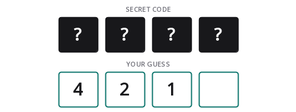

# Assignment 4: Description and Implementation of Dead or Wounded

## 1. Introduction

Dead or Wounded is a logical number-deduction game. The computer creates a
secret four-digit number, and the player tries to discover it by submitting
guesses. After each guess, the computer returns two clues:

- **Dead:** a digit exists in the secret and is in the correct position.
- **Wounded:** a digit exists in the secret but is in the wrong position.

The player combines clues from previous attempts until all four digits are dead.

This project is a complete Java Swing implementation with a hidden code rack,
numeric keypad, keyboard controls, guess history, attempt counter, elapsed timer,
new-game and give-up states, secret reveal, a rules dialog, and automated tests.

## 2. Rule variant used

Different descriptions of this game sometimes allow repeated digits or a
leading zero. This program uses a precise, common classroom variant:

1. The secret contains exactly four decimal digits.
2. The first digit cannot be zero, so the secret is a four-digit number.
3. No digit may appear more than once.
4. Every guess follows the same three restrictions.
5. Four dead digits wins immediately.
6. The player may make unlimited attempts or choose Give up.

Explicitly stating these decisions makes scoring and validation deterministic.

## 3. Running the project

Requirements: JDK 17 or newer and Bash.

```bash
cd /home/codestorm1875/School/CSC210/assignment4
./run.sh
```

Run the automated test suite with:

```bash
./test.sh
```

The project uses only the Java standard library. Maven, Gradle, JavaFX, and
external packages are not required.

## 4. Worked scoring examples

Assume the secret is:

```text
4 2 7 1
```

### Exact solution

```text
Guess:  4 2 7 1
Result: 4 dead, 0 wounded
```

Every digit and position match, so the game is solved.

### All digits misplaced

```text
Secret: 4 2 7 1
Guess:  1 7 4 2
Result: 0 dead, 4 wounded
```

All four digits exist, but none occupies its secret position.

### Mixed result

```text
Secret: 4 2 7 1
Guess:  4 2 1 7
Result: 2 dead, 2 wounded
```

Digits 4 and 2 are correctly positioned. Digits 1 and 7 exist but are swapped.

### No match

```text
Secret: 4 2 7 1
Guess:  5 6 8 9
Result: 0 dead, 0 wounded
```

None of the guessed digits occurs in the secret.

## 5. Scoring algorithm

`DeadOrWoundedGame.submitGuess` first validates the guess. It then performs one
loop over the four positions.

```java
int dead = 0;
int commonDigits = 0;

for (int index = 0; index < 4; index++) {
    char digit = guess.charAt(index);
    if (digit == secret.charAt(index)) {
        dead++;
    }
    if (secret.indexOf(digit) >= 0) {
        commonDigits++;
    }
}
```

`commonDigits` counts every guessed digit that exists anywhere in the secret.
That value includes the correctly positioned digits. Therefore:

```text
wounded = commonDigits - dead
```

Because both the secret and guesses contain unique digits, no additional
frequency map is required. Each digit can contribute at most once.

The method returns:

```java
new Feedback(dead, commonDigits - dead)
```

`Feedback` validates that neither count is negative and their total is not
greater than four.

## 6. Secret generation

The live game uses `SecureRandom`. The generator:

1. creates the list `0..9`;
2. shuffles it;
3. swaps the first element when it is zero;
4. takes the first four digits.

```text
digits before shuffle: 0 1 2 3 4 5 6 7 8 9
example shuffle:       6 1 9 3 0 7 4 2 8 5
secret:                6193
```

Shuffling guarantees distinct digits because each source digit occurs once.
The optional swap guarantees a nonzero first digit.

The generator accepts a `Random` object. Production uses `SecureRandom`, while
tests use a seeded `Random` so results are repeatable.

## 7. Model classes

### `Feedback`

An immutable record containing:

```java
int dead
int wounded
```

Its `solved()` method returns true when `dead == 4`.

### `GuessResult`

An immutable record containing:

- attempt number;
- submitted four-digit guess;
- calculated `Feedback`.

### `GameStatus`

The game has three explicit states:

```text
IN_PROGRESS -> WON
IN_PROGRESS -> GAVE_UP
```

Neither terminal state returns to `IN_PROGRESS`. A New game command creates a
new model.

### `GameSnapshot`

The GUI receives an immutable snapshot containing:

- an unmodifiable copy of guess history;
- current status;
- an optional revealed secret.

The secret is absent while the game is active. It becomes available only after
a win or give-up action.

### `DeadOrWoundedGame`

This class owns the secret, guess history, and lifecycle state. Its public
operations are synchronized:

```java
submitGuess(String guess)
giveUp()
snapshot()
```

Swing normally calls these methods from one event thread, but synchronization
also makes each state transition atomic if another caller is introduced later.

## 8. Input validation

The shared `validateCode` method checks both secrets and guesses:

```java
if (code == null || !code.matches("\\d{4}")) ...
if (code.charAt(0) == '0') ...
if (code.chars().distinct().count() != 4) ...
```

Invalid input produces a descriptive `IllegalArgumentException`.

The GUI prevents most invalid states before submission:

- it stops after four digits;
- it rejects a leading zero;
- it rejects a digit already present in the current input;
- it disables submission after the game ends.

The model still validates independently. GUI validation improves usability;
model validation protects correctness.

## 9. Swing interface

### Header

The header displays the game name, number of attempts, and elapsed time.

### Code rack

`CodeRackPanel` uses custom `Graphics2D` painting. The upper row contains four
hidden secret slots. During play they display question marks. The lower row
displays the player's current input.

When the game ends, the secret slots reveal the actual digits.

The rack geometry is responsive. Slot width and height are calculated from the
actual component size, with a tested compact height of 190 pixels. Dead and
wounded totals occupy a dedicated Swing layout row above the keypad instead of
a fixed canvas coordinate. This prevents feedback from being clipped or
covered when the play area is shorter.



### Numeric keypad

The keypad provides buttons 0-9, Clear, and Back. The **Check guess** command
submits a complete four-digit value.

Equivalent physical-keyboard controls are:

| Key | Action |
|---|---|
| `0` to `9` | Enter digit |
| Backspace | Remove last digit |
| Delete | Clear current guess |
| Enter | Check guess |

Key bindings use `WHEN_IN_FOCUSED_WINDOW`, so they work without forcing focus
onto a text field.

### Attempt history

The table shows:

```text
Attempt | Guess | Dead | Wounded
```

Every row comes directly from an immutable `GuessResult`. The table does not
recalculate feedback.

### Game commands

- **New game:** generates a fresh secret and resets input, history, feedback,
  attempts, and timer.
- **Give up:** ends the game, stops the timer, and reveals the secret.
- **Rules:** displays the implemented rule variant.

### Status band

The bottom-left status communicates input validation and the latest result. The
bottom-right legend keeps the two clue meanings visible.

## 10. Event flow

```text
keypad or keyboard
       |
       v
StringBuilder current input
       |
       v
submitGuess()
       |
       v
DeadOrWoundedGame validates and scores
       |
       +--> GuessResult --> history table
       |
       +--> GameSnapshot --> code rack and buttons
       |
       `--> Feedback --> status and indicators
```

All component mutations occur on Swing's event-dispatch thread. `Main` creates
the window with `SwingUtilities.invokeLater`.

The elapsed timer is a `javax.swing.Timer`; its events also execute on the Swing
thread, so no extra synchronization is required for labels.

## 11. Project structure

```text
assignment4/
|-- src/main/java/deadorwounded/
|   |-- Main.java
|   |-- model/
|   |   |-- DeadOrWoundedGame.java
|   |   |-- Feedback.java
|   |   |-- GameSnapshot.java
|   |   |-- GameStatus.java
|   |   `-- GuessResult.java
|   `-- ui/
|       |-- CodeRackPanel.java
|       |-- GuessTableModel.java
|       |-- MainFrame.java
|       `-- Theme.java
|-- src/test/java/deadorwounded/TestRunner.java
|-- ASSIGNMENT_EXPLANATION.md
|-- README.md
|-- run.sh
`-- test.sh
```

## 12. Test coverage

The dependency-free test runner verifies 26 properties:

1. Exact guess scores four dead.
2. Four dead is recognized as solved.
3. Fully misplaced digits score four wounded.
4. Mixed feedback separates dead and wounded.
5. Unrelated digits score zero.
6. Attempt numbers increase.
7. History contains every guess.
8. The latest result is identifiable.
9. Active games hide the secret.
10. A new game is in progress.
11. A correct guess changes status to won.
12. A win reveals the secret.
13. Give up changes status.
14. Give up reveals the secret.
15. Guesses after termination are rejected.
16. Short guesses are rejected.
17. Nondigits are rejected.
18. Leading zero is rejected.
19. Repeated guess digits are rejected.
20. Repeated secret digits are rejected.
21. Generated secrets always contain four digits.
22. Generated secrets never start with zero.
23. Generated secret digits are distinct.
24. Snapshot history cannot be modified.
25. A failed snapshot mutation does not alter the game.
26. The code rack paints nonblank pixels in headless mode.

The random-generator assertions examine 250 generated secrets using a
deterministic seed.

## 13. Complexity

The code length is fixed at four, so all scoring operations are constant time in
practice. For a generalized code length `N`:

| Operation | Time | Extra space |
|---|---:|---:|
| Validate one code | `O(N)` | `O(N)` for distinct stream state |
| Score one guess with `indexOf` | `O(N^2)` | `O(1)` |
| Create a snapshot | `O(A)` | `O(A)` |
| Render the rack | `O(N)` | `O(1)` |

`A` is the number of previous attempts. With `N = 4`, the direct scoring method
is clearer than adding frequency data structures.

## 14. Example deduction

Suppose the hidden code is `4271`.

```text
Guess 5689 -> 0 dead, 0 wounded
```

Digits 5, 6, 8, and 9 can be eliminated.

```text
Guess 1742 -> 0 dead, 4 wounded
```

All four required digits are known, but every position is wrong.

```text
Guess 4217 -> 2 dead, 2 wounded
```

The first two positions are correct, and the final two digits need swapping.

```text
Guess 4271 -> 4 dead, 0 wounded
```

The code is solved.

This demonstrates that the game depends on set membership, position comparison,
elimination, and permutation reasoning.

## 15. Limitations and extensions

1. The current variant always uses four distinct digits.
2. Results are not persisted after the application closes.
3. There is no online leaderboard or network multiplayer.
4. The computer generates the secret; a second human cannot enter one privately.
5. Accessibility could be extended with spoken clues and full keyboard focus
   traversal.

Possible extensions include configurable code lengths, repeated-digit mode,
limited attempts, difficulty levels, statistics saved to a file, and a reverse
mode where the computer deduces a human secret.

## 16. Suggested demonstration

1. Run `./test.sh` and show all 26 checks passing.
2. Run `./run.sh`.
3. Attempt to enter zero first and show validation.
4. Attempt to repeat a digit and show rejection.
5. Submit two valid guesses and compare rack feedback with the history table.
6. Use keyboard digits, Backspace, Delete, and Enter.
7. Select Give up to demonstrate secret reveal.
8. Start a new game and show all state and timing reset.
9. Explain the `commonDigits - dead` calculation in the model.

## 17. Conclusion

The project turns a small mathematical deduction game into a complete Java GUI
application. The model cleanly separates validation, scoring, lifecycle, and
secret visibility from presentation. The Swing layer provides a responsive code
rack, keypad, keyboard control, timing, history, and clear feedback, while the
test suite proves the important rules independently of the interface.
